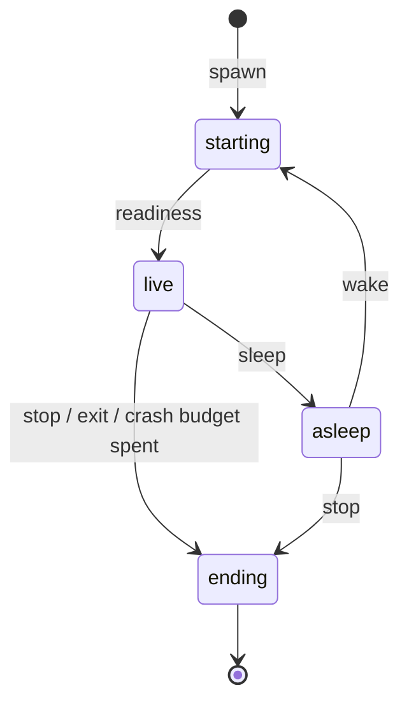

# Sleep and wake, step one: the two commands, the `asleep` status and Pi

Status: design, no code. Refs #10952 (step one of #10943).

Every claim about what exists today names a file and line on `main` at `345d6f8b5d`. What is
proposed is written as "will" or as a MUST in SPEC text.

## 0. New public surface, in one list

Everything below is new. Nothing that runs today changes its arguments, output, exit status or
wire shape, with one exception that the SPEC change allows: a presence reader that meets
`asleep` (section 3).

Commands and flags

- `cotal sleep <name> [--on <instance>] [--json|--plain]`, with the same target flags as
  `cotal stop` (`implementations/cli/src/commands/agents.ts:89`).
- `cotal wake <name> [--on <instance>] [--json|--plain]`, with the same flags.
- No new flags on any existing command.

Exit statuses (all from the existing table, `docs/cli-usage.mdx:468-476`)

- 0 for a completed sleep or wake, and for `no-op` (the agent was already asleep, or already
  awake under the same lifecycle).
- 2 with `LIFECYCLE_BLOCKED` for each state refusal in section 1, `UNSUPPORTED` for a harness or
  runtime that cannot sleep, and `CONFLICT` for a wake at the seat cap or the Manager ceiling.
- 2 with `TARGET_UNAVAILABLE` from an older Manager or an older hosted side (section 4).
- 3 `OPERATION_UNKNOWN` when the Manager did not confirm the outcome, as for `stop` today.

JSON fields

- `cotal sleep --json`: `result: { name, lifecycleUid, sessionId, asleepAt, wakeBy? }`.
- `cotal wake --json`: `result: { name, lifecycleUid, sessionId, asleepForMs, storedCopiesFull?: { limit } }`.
- `ps` row: `status` already takes any string (`packages/core/src/manager-contract.ts:29`). A
  sleeping row reads `status: "asleep"`, `mesh: "asleep"`. No new row field.

Wire

- `PresenceStatus` gains `asleep` (`packages/core/src/types.ts:59`, SPEC §6).
- Presence gains the optional `asleepSince` (epoch ms) and `wakeBy` (epoch ms). Both appear only on
  an `asleep` record.
- Two Manager cluster commands, `sleep` and `wake`, at revision 59.
- One new credential profile, the presence keeper, whose only publish row is one sleeping agent's
  presence key (section 2). No row is added to any existing profile.
- The seat record `cotal-seat-record/v2`. It is shared with the permanent agent ID design (draft
  #10893), and both designs use the same shape (section 5).
- One new connector control op, `quiesce`, sent only to a connector that declares it.
- An optional `rootExpiresAt` (epoch ms) on the agent bearer exchange answer, which the auth
  service fills in and an older one omits (section 6).

Exported names

- `Connector.supportsSleep?: boolean` (`packages/core/src/connector.ts`, beside
  `supportsSessionContinuation` at `:461`).
- `Runtime.sleepPolicy?: "stop" | "pause"`, the runtime's declaration of how it sleeps
  (`packages/core/src/runtime.ts`, beside `supportsWorkClosure` at `:135`).
- `presenceAsleepKeySubject(space, owner, actor)`, which builds the grant row (section 2).
- `SleepRecord`, the `sleep` object of the v2 seat record.

Sentences (each is placed in sections 1, 4 and 6)

- "`<name>` is not running, so there is nothing to put to sleep"
- "`<connector>` cannot continue the same conversation after a restart, so `<name>` cannot sleep;
  stop it instead if it should end"
- "runtime `<kind>` cannot stop a seat and start it again later, so `<name>` cannot sleep"
- "`<name>` holds workflow turn `<goalId>`; it can sleep after it yields the turn"
- "`<name>` is still starting; it can sleep once it is ready"
- "`<name>` runs one task and ends, so it cannot sleep"
- "`<name>` runs outside this Manager, so this Manager cannot put it to sleep"
- "`<name>` cannot sleep: its credential expires at `<UTC>`, and nothing renews it while it sleeps;
  stop it and start a new agent instead"
- "this Manager cannot tell when `<name>`'s credential expires, so it cannot sleep it safely;
  update the auth service"
- "`<name>` is in a turn (`<reason>`); it can sleep when the turn ends"
- "`<name>` did not stop within `<ms>`; it is still running and is not asleep"
- "`<name>` can stay asleep until `<UTC>`"
- "no sleeping agent `<name>` on this Manager"
- "`<name>` slept past its credential's expiry at `<UTC>`, so it cannot wake without a new grant;
  stop it and start a new agent. Its waiting messages stay with the old agent and are not carried
  over"
- the existing capacity sentence, then "`<name>` stays asleep and its messages stay kept"
- "the conversation `<sessionId>` that `<name>` slept in is gone, so it did not wake; stop it and
  start a new agent"
- "`<name>` woke into conversation `<got>`, not `<want>`; it was stopped and stays asleep"
- "the Manager `<instance>` runs a release without `sleep`; nothing was sent. Update that Manager
  to put agents to sleep"
- the first-turn notice: "While you were asleep, your stored copies reached their limit of
  `<limit>`, so older channel posts may have been dropped. Channel history may still hold them:
  `cotal history <channel>` reads it."

## 1. The state machine

A managed seat is in one of four Manager states. `starting`, `live` and `ending` exist today as
the seat's handle status plus its `terminalizing` latch (`implementations/manager/src/seat-types.ts:251-255`).
`asleep` is new.



Only a `live` seat may sleep. An `asleep` seat holds no process, no handle, no control endpoint and
no slot in `agents`. It keeps its lifecycle UID, its credentials on disk, its durable consumers and
its alias.

### `sleep`, in order

1. **Authorize.** Use the same check `despawn` uses: `authorizeNamed` with the any-mode admin flag
   (`implementations/manager/src/command-dispatch.ts:429-434`, policy at
   `implementations/manager/src/authorize.ts:32-61`). Whoever may despawn an agent may sleep it.
2. **Refuse when the seat cannot sleep**, before any effect, in this order:
   - Not live. The handle is not `running`, or the seat is `terminalizing` or `recovering`:
     "`<name>` is not running, so there is nothing to put to sleep".
   - The connector does not declare `supportsSleep`: "`<connector>` cannot continue the same
     conversation after a restart, so `<name>` cannot sleep; stop it instead if it should end".
     This is the by-name refusal. No fork and no fresh start.
   - The runtime declares no `sleepPolicy`: "runtime `<kind>` cannot stop a seat and start it
     again later, so `<name>` cannot sleep".
   - The seat holds a workflow turn. `pendingForSeat` returns one
     (`implementations/manager/src/turn-relay.ts:267-269`): "`<name>` holds workflow turn
     `<goalId>`; it can sleep after it yields the turn".
   - The seat has a spawn goal still open (`agentGoals`, `implementations/manager/src/seat-stop.ts:574-578`):
     "`<name>` is still starting; it can sleep once it is ready".
   - A `once` seat (`implementations/manager/src/seat-types.ts:246`): "`<name>` runs one task and
     ends, so it cannot sleep".
   - The seat is a delegated or handed-off seat (`handedOff`, `implementations/manager/src/seat-stop.ts:190`):
     "`<name>` runs outside this Manager, so this Manager cannot put it to sleep".
   - On a user-auth mesh, the root credential has 24 hours or less left (section 6):
     "`<name>` cannot sleep: its credential expires at `<UTC>`, and nothing renews it while it
     sleeps; stop it and start a new agent instead".
3. **Quiesce, then refuse mid-turn.** The Manager sends `quiesce` on the seat's authenticated
   control endpoint (`extensions/connector-core/src/control.ts:251-268`, next to `shutdown` and
   `session`). The connector answers `{ ok: true, sessionId }` only when its driver is idle and
   holds nothing. For Pi that means the driver is `idle` with no batch, command or take in flight
   (`extensions/pi/src/driver.ts:97-104`). From then on the connector takes no new turn until
   the process exits. If the driver is busy, the answer is `{ ok: false, reason }` and the
   refusal is "`<name>` is in a turn (`<reason>`); it can sleep when the turn ends". Checking
   status `working` from presence is not enough, because a batch can be dispatched between the
   read and the stop. The connector holds the gate itself.
4. **Record the sleep.** Write the v2 seat record with `state: "asleep"` and
   `sleep: { at, sessionId, reopen, wakeBy? }` before the process is touched. `sessionId` is the
   one `quiesce` returned, and it must equal `readManagedSession`
   (`implementations/manager/src/session-recovery.ts:187-192`). `reopen` is true when the session
   file already exists (Pi wrote a turn). It is the same distinction the code draws between
   `continueSession` and `reopenSession` (`packages/core/src/connector.ts:134-145`). The write is
   atomic (`implementations/manager/src/resume.ts:233-238`). If the write fails, the sleep stops
   here and the seat stays live.
5. **Presence.** The Manager writes the `asleep` record for the seat (section 2) and keeps it
   alive.
6. **Stop the process, keep the lifecycle.** The sleep path does not call `freeSlot`. Each step
   of `freeSlot` would end something the sleep keeps. It removes the session-state file
   (`implementations/manager/src/names-capacity.ts:200`) and drops the seat record (`:204`). It
   fails the seat's turns (`:219`) and takes the retirement hold (`:234-243`). It also starts the
   deprovision unless `suppressCleanup` is set (`:248-254`). Sleep sets `suppressCleanup` and the
   `terminalizing` latch (`implementations/manager/src/seat-types.ts:250-255`), so the exit watcher
   does not restart the seat (`implementations/manager/src/seat-stop.ts:446`). Sleep also moves the
   seat from `agents` to the `asleep` table before the stop, so the watcher's `freeSlot` call
   (`implementations/manager/src/seat-stop.ts:460`) returns at its guard
   (`implementations/manager/src/names-capacity.ts:194`). Sleep then stops the handle gracefully. The connector's graceful stop publishes a final `offline` record
   (`packages/core/src/endpoint-connection.ts:923-926`). For that reason step 5 runs again after
   the exit, so the last write on the key is `asleep`. The runtime's `waitForExit` must prove the
   exit (`packages/core/src/runtime.ts:61`), as the preservation stop does today
   (`implementations/manager/src/preservation.ts:474-484`). An exit the runtime cannot prove
   leaves the seat `live`, with the error "`<name>` did not stop within `<ms>`; it is still
   running and is not asleep".
7. **Hold the name.** The `asleep` table reserves the alias against a spawn under the same name
   (section 5). If the exit could not be proved, the seat goes back into `agents` as live, with both flags cleared.

The reply is `{ name, lifecycleUid, sessionId, asleepAt, wakeBy? }`.

### `wake`, in order

1. **Authorize** with the same check as `sleep`.
2. **Refuse when the seat cannot wake:**
   - Not asleep. If it is live under the same lifecycle, the answer is `no-op`. If the name is
     unknown: "no sleeping agent `<name>` on this Manager".
   - Past `wakeBy`: "`<name>` slept past its credential's expiry at `<UTC>`, so it cannot wake
     without a new grant; stop it and start a new agent. Its waiting messages stay with the old
     agent and are not carried over". Nothing is started. The record stays until `stop`.
   - At the seat cap (`implementations/manager/src/names-capacity.ts:350`) or the Manager ceiling
     (`MAX_AGENTS`, `implementations/manager/src/resume.ts:13`): the existing capacity sentence
     (`implementations/manager/src/names-capacity.ts:300-307`), followed by "`<name>` stays asleep
     and its messages stay kept". The CLI maps this to `CONFLICT`, as it does for spawn
     (`implementations/cli/src/commands/spawn-managed-launch.ts:321-326`).
   - In Pi, the conversation file is gone when `reopen` is true: "the conversation `<sessionId>` that `<name>`
     slept in is gone, so it did not wake; stop it and start a new agent". Waking into a fresh
     conversation is a separate decision for the project owner. Until it is made, wake refuses, which
     never loses a conversation and never pretends to keep one.
3. **Relaunch through the existing resume launch.** That launch is `resumePreservedAgent`
   (`implementations/manager/src/preserved-resume.ts:877-1043`), and it already does every check a
   wake needs. It validates retained authority (`:667`), resolves the connector and refuses one
   that cannot continue (`:948-949`), and launches with `continueSession` or `reopenSession`
   (`:1019-1020`). The supervised restart already enters it the same way
   (`implementations/manager/src/seat-custody.ts:62`, `:324`). Wake passes the entry from the
   seat record and sets `reopenSession` when `sleep.reopen` is true.
4. **Prove the session.** The relaunched process must report the recorded session id on its
   control endpoint (`implementations/manager/src/session-recovery.ts:244-266`). Pi itself refuses
   a different one at start (`extensions/pi/src/extension.ts:232-233`, `:253-254`). A mismatch
   stops the new process and leaves the seat asleep: "`<name>` woke into conversation `<got>`, not
   `<want>`; it was stopped and stays asleep".
5. **Record the seat as live.** Rewrite the seat record with `state: "live"` and no `sleep`
   object. The agent's own connection then takes over its presence key, and the Manager stops
   writing it.

The reply is `{ name, lifecycleUid, sessionId, asleepForMs, storedCopiesFull?: { limit } }`.

### `stop` of a sleeping agent

`despawn` will accept a sleeping target. It runs the ordinary terminal (`freeSlot` with
`suppressCleanup` false), with no process to stop, and deletes the `asleep` presence record. An
explicit stop still ends the lifecycle for good.

## 2. Who writes `asleep`, and the grant

Today only the seat's own credential may write its presence key
(`packages/core/src/provision-permissions.ts:579`), and the supervisor may write only its own key
(`packages/core/src/provision-permission-builders.ts:127`). The
presence bucket has a 6 s TTL (`packages/core/src/streams.ts:75`, `:615`). A peer ages a record
out after 6 s (`packages/core/src/endpoint-presence.ts:891`).

Two options:

| | Manager writes it | The record outlives the process |
|---|---|---|
| Liveness | Heartbeat every 2 s like any record | Needs a per-key TTL longer than the bucket's, or no TTL on that key |
| Broker change | One grant row | A per-message TTL on a bucket created without `allow_msg_ttl`, which every existing space would have to recreate (`packages/core/src/streams.ts:599-624` drives creation from one list) |
| Manager down | Record ages out to `offline`, and peers see the truth: nobody can wake it | Record says `asleep` while nobody can wake it |
| Stop or crash | Manager stops writing, the key ages out | A stale `asleep` lingers until the TTL |

**The Manager writes it.** The record then stays honest when the Manager is off, and the broker
does not have to change.

### The grant row

The supervisor's credential (`packages/core/src/provision-permission-builders.ts:104-176`) is not
widened. Each sleeping seat gets its own short-lived keeper credential, held by the Manager, with
one publish row that covers only that seat's presence key, only while the seat sleeps:

```
$KV.cotal_presence_<space>.<owner>.<actor>
```

That one subject cannot reach any other key. A KV put is a publish to the key's own subject, so a
grant on that subject is an exact-key grant, the same shape as the seat's own row
(`packages/core/src/subjects.ts:534-536`).

A standing wildcard such as `$KV.cotal_presence_<space>.>` on the supervisor would let the Manager
forge every agent's presence, so the row is never standing and never on the supervisor. How the
keeper credential is minted:

- **User-auth mesh (the Manager's view is minted per request).** The auth callout already mints
  rows on request, pinned to a target. The precedent for a one-row consumer-info grant is
  `activatorGrants` (`packages/core/src/endpoint-virtual.ts:126-136`). A `sleep` mints a short-lived
  "presence-keeper" credential whose only publish row is that key, plus its inbox and `$JS.API.INFO`.
  The minting decision checks that the requesting Manager holds the seat in its seat record for
  that lifecycle. That is the same authority `despawn` checks, so no new permission.
- **Static-auth mesh.** The Manager signs credentials itself. It mints the same one-row credential
  from its own signing key for the seat it holds.

The keeper is a separate connection with `registerPresence: false`, `consume: false` and
`watchPresence: false` (options at `packages/core/src/endpoint-options.ts:341-344`), so it cannot
read, consume or reply as the agent. It writes one record every 2 s: the seat's card from the
seat record, `status: "asleep"`, `asleepSince`, `wakeBy`, the seat's `lifecycleUid`, and no
`runtime` (no process holds the connection; `runtime` is optional, SPEC §6 line 455).

What stops the keeper writing another agent's record: the broker. Its credential carries one
publish row, and SPEC §6 line 482 ("An instance MUST write only its own presence key") is held by
the grant rather than by the writer's good behavior. A record it wrote for the wrong key would also
be dropped by every reader, because `card.id` must equal the key
(`packages/core/src/subjects.ts:569`).

On wake, the keeper is closed and its credential revoked before the agent's process starts. That
way two writers never share the key.

## 3. Older readers, and the SPEC text

### What an older side does with `asleep`

- **Older client (a reader from 0.113.0 on, where the shared row check landed in `29c67fee8e`;
  earlier readers were not checked).** `isPresenceRow` rejects an unknown status
  (`packages/core/src/subjects.ts:538`, `:572`). The watch and the on-demand read drop the record
  and emit a warning (`packages/core/src/endpoint-presence.ts:750-753`). A peer that had seen the
  agent keeps its last row until the sweep marks it `offline` after 6 s
  (`packages/core/src/endpoint-presence.ts:884-894`). A new peer never sees it, which is exactly
  today's measured behavior (#10943). The record is dropped every 2 s, so the warning repeats, and
  it reaches the Manager's log (`implementations/manager/src/boot.ts:354-356`) and the delivery
  daemon's log (`implementations/delivery/src/delivery.ts:365-368`).
- **Older Manager.** It never writes `asleep`, and the commands are not in its document
  (section 4).
- **Older delivery daemon.** It resolves a mention by name over its roster
  (`packages/core/src/endpoint-durable-backstop.ts:322-325`). With the record dropped, the name is
  absent, so a mention of a sleeping agent adds no live-channel copy. A durable channel still
  stores the copy, because its fan-out reads the members registry, not presence
  (`packages/core/src/endpoint-delivery-plane.ts:866-885`).

To keep older readers quiet, a new reader will log a dropped record once per key and status,
rather than every 2 s. That changes only the new side.

### What a new reader does with `asleep`

`asleep` is not live and not absent. Every site that asks "is it live" by `status !== "offline"`
must decide which it means:

| Meaning | Sites | `asleep` counts as |
|---|---|---|
| addressable: a DM, a mention, a name lookup | `extensions/connector-core/src/agent-messaging.ts:251-264`, `:360-414`; `packages/core/src/resolve.ts:91`, `:115`; `packages/core/src/endpoint-durable-backstop.ts:322-325` | present |
| reachable now: a turn, an anycast holder, a seat read | `implementations/manager/src/manager.ts:1501`; `extensions/connector-core/src/agent.ts:981`, `:1009`; `packages/workspace/src/control/seat-presence.ts:9` | not live |
| name occupancy | `implementations/manager/src/names-capacity.ts:144` | occupied |
| readiness and resume proofs | `implementations/manager/src/readiness-wait.ts:99`; `implementations/manager/src/preserved-resume.ts:531`, `:562`, `:866`, `:1249` | not live (a process must prove itself) |
| display | `implementations/cli/src/commands/who.ts`, `implementations/cli/src/commands/send.ts:553`, `packages/workspace/src/view/mesh-view.ts:639` | its own word |

`toOffline` already drops the process-only fields (`packages/core/src/endpoint-presence.ts:840-842`).
An `asleep` record carries none of them. A new reader treats an `asleep` record past the TTL as
`offline`, like any other, because a Manager that stopped writing is the truth.

### SPEC diff (§6)

```diff
-| `status` | `PresenceStatus` | MUST | `idle`, `waiting`, `working`, or `offline` |
+| `status` | `PresenceStatus` | MUST | `idle`, `waiting`, `working`, `asleep`, or `offline` |
+| `asleepSince` | number | MAY | epoch ms the agent fell asleep. Present only when `status` is `asleep` |
+| `wakeBy` | number | MAY | epoch ms after which the agent cannot wake without a new grant (§13.1). Present only when `status` is `asleep`, and only on a mesh whose root credential expires |
```

```diff
 An instance MUST refresh its own presence entry on the heartbeat interval, default 2000 ms.
 The liveness window defaults to 6000 ms. A peer whose `ts` is older than the liveness window
 is considered `offline`.
+
+`asleep` means the agent has no running process, keeps its lifecycle, and can be woken by the
+Manager that holds it. Its messages are stored for that lifecycle (§8). The holding Manager
+writes the record through a credential whose only presence row is that agent's key (Appendix B),
+heartbeats it like any record, and stops when the agent wakes or ends. A reader MUST treat an
+`asleep` agent as addressable: a direct message, a mention and a name lookup resolve to it. A
+reader MUST NOT treat it as running: it does not prove readiness, take a turn, or hold an
+anycast role. An `asleep` record past the liveness window reads `offline`, which says nobody is
+keeping it.
+
+A reader at or after this revision that meets a `status` it does not know MUST drop the record as
+today, and SHOULD report that once per key and status rather than on every heartbeat. A reader
+from before this revision drops an `asleep` record: to it the agent is absent, as an offline
+agent it never saw is today.
```

The `PresenceStatus` enum in `spec/cotal.schema.json:641-650` gains `asleep`. The schema file is
generated (`package.json:79`, `gen:schema`), so it changes with the type.

## 4. The Manager command document

Today: revision 58 (`implementations/manager/src/manager-service-contract.ts:1374`, SPEC §13.9
line 1168, where the prose still reads 57). Despawn row:
`implementations/manager/src/manager-service-contract.ts:1111`.

Revision 59 adds two rows. Both follow `despawn`: `capability: "manager.lifecycle"`,
`targeted: true`, `modes: ["owner", "any"]`.

| Command | Input (closed) | Output (closed) |
|---|---|---|
| `sleep` | `{}` | `{ name, lifecycleUid, sessionId, asleepAt, wakeBy? }` |
| `wake` | `{}` | `{ name, lifecycleUid, sessionId, asleepForMs, storedCopiesFull?: { limit } }` |

The target is the same triple `despawn` takes, and an asleep target resolves through the
`asleep` table as well as `agents` (`implementations/manager/src/command-dispatch.ts:314-320` reads
`agents` only). The CLI maps `sleep` and `wake` the way it maps `stop`
(`packages/workspace/src/control/manager.ts:88-97`).

Grants. `despawn` rides `SPAWN_OWNER_LIFECYCLE_COMMANDS` and `PERSON_SEAT_COMMANDS`
(`packages/core/src/endpoint-grants.ts:207`, `:228`). `sleep` and `wake` join both lists, so whoever
holds `despawn` holds them, and no new permission is added. The run driver's `despawn` row
(`packages/core/src/run-driver-grants.ts:147`) is not extended in this step. Run pause is a later
step.

**What an older side answers.**

- *Older Manager (revision 58 or older):* the commands are not in its describe. The caller
  refuses before sending anything (`packages/core/src/endpoint-caller.ts:237`). The CLI prints
  "the Manager `<instance>` runs a release without `sleep`; nothing was sent. Update that Manager
  to put agents to sleep", and exits 2 with `TARGET_UNAVAILABLE`.
- *Older hosted side:* a host that validates the Manager through generated contracts refuses a
  cluster digest it did not generate, as `unsupported-version`, before any command is sent
  (`packages/core/src/browser-control.ts:105-110`). Whether the hosted backend uses that path is
  not visible in this repository. Either way, the rule is the one every earlier revision followed:
  the release with revision 59 waits until the hosted side deploys it. Until then, a hosted
  caller gets its own refusal, and nothing runs.

## 5. The store on disk

No third store. A sleeping seat lives in the record a supervised and adoptable seat already
writes: `.cotal/seat-records/<space>/<name>.json` (`implementations/manager/src/resume.ts:214-238`).
That record carries the full resume entry (`implementations/manager/src/preserved-resume.ts:241-312`),
with every secret by file reference and digest, never by value.

### `cotal-seat-record/v2` (shared with the permanent agent ID design, #10893)

Both designs carry this shape. `reopen` was added for the reason in section 7, and #10893 carries
it too.

```ts
{
  version: "cotal-seat-record/v2",
  instanceId, supervise?, crashes, agent,        // v1 fields, unchanged
  state: "live" | "asleep" | "ended",            // required
  agentUid?: string,                             // permanent ID, server-acknowledged; absent when unlinked
  sleep?: { at: number, sessionId: string, reopen: boolean, wakeBy?: number },
}
```

- `sleep` is required when `state` is `asleep` and absent otherwise.
- `wakeBy` is set only on a user-auth mesh (section 6).
- A v1 record reads as `state: "live"`, unlinked.
- This step writes only `live` and `asleep`, never `ended`. `ended` belongs to the permanent-ID
  steps.
- `asleep` keeps the exact resume entry and lifecycle and wakes the same run. It does not count
  against the seat cap or the Manager ceiling, and it holds its alias the way a reservation does
  (`implementations/manager/src/names-capacity.ts:118`).

### Across a Manager restart

The boot sweep reads active slots and takes back seats with a record
(`implementations/manager/src/managed-static-lifecycle.ts:885-916`). A static slot whose record
reads `asleep` is held as asleep: no adopt, no restart, no terminal, and the keeper starts again.
A user-auth Manager today writes seat records only at release
(`implementations/manager/src/preservation.ts:533-535`) and adopts only records with a
`.runtime-ref` (`:556-568`). It will read `asleep` records from the same directory at boot and hold
them the same way. A sleeping seat holds no process, so a Manager stop or `update` has nothing to
stop or release for it. The legacy update report lists `ps` rows (`implementations/cli/src/commands/update-continuity.ts:434-450`).
An asleep row will be listed under its own heading as kept, not as a seat that ends.

### Update from a release without sleep, and back

- **Forward (v1 to v2).** Every v1 record reads as `live`, so nothing changes.
- **Back.** A reader from before v2 parses with a strict schema (`implementations/manager/src/resume.ts:219-225`),
  so a v2 record throws. For a static slot, `seatRecordFor` turns that throw into "the lifecycle is
  retired, not restarted" (`implementations/manager/src/seat-custody.ts:191-198`). A rollback would
  therefore retire every sleeping agent. So the order is:
  1. **Reader release.** It reads v1 and v2. A record whose `version` or `state` it does not know
     is left alone: no adopt, no cleanup, no retirement. It writes v1 only. A malformed v1 record
     is handled as today.
  2. **Writer release, one release later.** This step's `sleep`, and the permanent-ID writer, write v2.
  A rollback from the writer release to the reader release keeps every asleep record, unwoken and
  unretired, until the writer release returns. A rollback past the reader release is the one case
  this cannot cover, and the writer release's changeset says so.

## 6. The three requirements from the measurements on #10943

### Dropped channel posts on wake

Channel delivery keeps 1,000 copies per lifecycle and drops the oldest
(`packages/core/src/backup-config.ts:205`, `:234`, measured in #10943). A seat already learns that a
copy arrived on a full store: the delivery header carries the limit, and
`m.info.pending >= limit - 1` raises `stored-copies-full`
(`packages/core/src/endpoint-delivery-plane.ts:1126-1133`). That note is shown in `cotal_inbox`
(`extensions/connector-core/src/tool-specs-inbox.ts:489`, `:550-554`), but not in a Pi automatic
turn, which renders through `formatInjection` (`extensions/connector-core/src/control.ts:111`,
`extensions/pi/src/driver.ts:446`, `:468`).

On wake, the Manager reads the seat's delivery consumer before it starts the process. It reads
`num_pending` through a one-row grant. It has the same shape as the DM-consumer row that #10943
measured as giving the right count, but this row is for the delivery consumer, which #10943 left
denied and did not measure, so cell 7 measures it
(`$JS.API.CONSUMER.INFO.DLV_<space>.dlv_<owner>-<actor>-<uid>`), minted with the keeper
credential on the same terms. NATS does not report a discard
(`packages/core/src/endpoint-delivery-plane.ts:1125-1127`), so the count cannot be proved. What
can be proved is that the store is full: `num_pending` at or above the limit stamped on the copies
means older copies may have been dropped. The wake reply then carries `storedCopiesFull: true`
with the limit, the CLI prints it, and the first turn after wake starts with this notice, sent
through the driver's existing notice queue (`extensions/pi/src/driver.ts:155-164`):

> While you were asleep, your stored copies reached their limit of `<limit>`, so older channel
> posts may have been dropped. Channel history may still hold them: `cotal history <channel>`
> reads it.

When the store is not full, nothing is said. No exact dropped count is reported,
because no broker read proves one.

### The 90-day limit

A user-auth root credential lives 90 days and is not renewed
(`implementations/auth/src/root-credential.ts:54-59`, applied at `:120`). An expired root refuses
the exchange (`:106`). Until #10836 lands:

- `sleep` reads the root's expiry and records `wakeBy` = expiry minus one hour. The Manager has no
  read of the root's expiry today (the exchange answer is `{ bearer, sentinelCreds, authority? }`,
  `packages/core/src/auth-provider.ts:586-590`). The reader release adds an optional `rootExpiresAt`
  to the agent bearer exchange answer. An older auth service omits it, and `sleep` then refuses:
  "this Manager cannot tell when `<name>`'s credential expires, so it cannot sleep it safely;
  update the auth service".
- `sleep` refuses with 24 hours or less left (section 1).
- The CLI prints "`<name>` can stay asleep until `<UTC>`".
- `wake` after `wakeBy` refuses as in section 1.

A static-auth seat's credential is renewed by the Manager from its seed
(`implementations/manager/src/credential-renewal.ts:524`). There is no root, so there is no
`wakeBy`. The renewal loop will include asleep seats.

### The presence writer

Section 2.

## 7. Pi

Pi continues the exact session today. After a crash, it relaunches with `--session-id <id>`
(`extensions/pi/src/connector.ts:196`). For a manifest `continuity: exact` launch, it reopens an
existing session with `--session <id>`, which exits when there is none (`:190-195`). The extension
refuses a different session at start (`extensions/pi/src/extension.ts:232-233`, `:253-254`). The
session id is kept in a per-lifecycle state file (`extensions/pi/src/connector.ts:158-159`,
`extensions/pi/src/extension.ts:86-91`). `buildLaunch` removes that file at launch (`:220`), and
the extension writes it again at start.

Wake uses `reopenSession` when `sleep.reopen` is true, so a deleted conversation is refused rather
than recreated empty. It uses `continueSession` when false, which is a seat that never took a turn.
Pi declares `supportsSleep: true`. The Pi extension serves `quiesce` from its driver state.

Every other connector leaves `supportsSleep` unset and is refused by name (section 1). That is
default-deny, the same rule as `supportsSessionContinuation` (`packages/core/src/connector.ts:459-461`).
The Manager never sends `quiesce` to a connector that does not declare `supportsSleep`. An older
connector's control server passes any op other than `shutdown` and `session` to its hook handler
(`extensions/connector-core/src/control.ts:270-279`), so sending it would be meaningless.

The runtime: the built-in `pty` runtime declares `sleepPolicy: "stop"`
(`implementations/manager/src/runtime/pty.ts:25-26`). A runtime that pauses a sandbox and keeps its
disk would declare `pause`. A runtime that declares neither refuses `sleep`. How a seat sleeps is
therefore a property of the Runtime contract, not of the connector. The connector only says
whether it can continue the conversation.

## 8. Cells

Each cell runs on a real `nats-server` with the built CLI (`node bin/dist/cotal.js`), a private
HOME, COTAL_HOME, XDG_CONFIG_HOME and TMPDIR, every COTAL_* unset, `DO_NOT_TRACK=1`, and real Pi
from `extensions/pi/node_modules/.bin`, configured through `models.json` as
`bin/smoke/pi-standalone-spawn-live.smoke.ts:49-72` does. The provider is a local HTTP server in
the cell that serves the model `gpt-6.2-sol`, answers each turn, and records each request, so
"the DM is in the first turn" is read from the first recorded request after wake. No service is
installed or started outside the cell.

| # | Cell | Fails on |
|---|---|---|
| 1 | Acceptance: spawn Pi, sleep it, peer A (saw it) and peer B (joined later) each DM it, both see `asleep`, wake it | lifecycle UID changes, session id changes, a pid exists while asleep, either DM missing from the first turn, either peer reading anything but `asleep` |
| 2 | Sleep mid-turn | a sleep that succeeds while the driver is busy, or a process that stopped |
| 3 | Sleep a seat holding a workflow turn | any effect before the refusal |
| 4 | Sleep a Claude Code seat (`claude-opus-5-5`) | anything but the by-name refusal and exit 2 `UNSUPPORTED` |
| 5 | Sleep, restart the Manager, wake | the seat retired or adopted at boot, or `asleep` missing after the restart |
| 6 | Sleep on the reader-only release, roll back | (writer release) a sleeping record retired by the reader release |
| 7 | 1,001 posts while asleep | `storedCopiesFull` missing from the wake reply, or the notice missing from the first turn; and with 999 posts, either one present |
| 8 | Root lifetime shortened (as #10853's cells do), sleep, let it pass `wakeBy`, wake | anything started, or the refusal sentence missing |
| 9 | Wake at the seat cap | a process started, or the DM lost after the refusal |
| 10 | Keeper credential writes another agent's key | the broker accepting the write |
| 11 | `stop` a sleeping agent | an `asleep` record left behind, or the alias still held |
| 12 | `sleep` against a revision-58 Manager | anything sent, or a sentence other than section 4's |
| 13 | Delete the Pi session file while asleep, wake | a woken process, or a fresh conversation |

## 9. Pull requests, in order

Each ships alone and passes its own cells.

1. **Seat record v2 reader** (about 120 lines and a smoke). Reads v1 and v2, leaves an unknown
   version or state alone, writes v1. Shared with #10893, and whichever of the two lands first
   carries it. Cell 6, reader half.
2. **`asleep` presence value and readers** (about 250 lines). The type, the reader rules from
   section 3, the warning sent once, the SPEC §6 text and the schema. No writer. Cells: reader unit
   checks on a hand-written `asleep` record.
3. **Root expiry on the exchange answer** (about 60 lines, auth). Optional `rootExpiresAt`. Waits
   on #10853.
4. **Keeper credential and grant row** (about 200 lines). `presenceAsleepKeySubject`, the one-row
   mint on both auth modes, and the SPEC Appendix B row. Cell 10.
5. **`sleep` and `wake`, revision 59, Pi, CLI** (about 600 lines, held for the hosted deploy).
   `supportsSleep`, `sleepPolicy`, `quiesce`, the state machine, the CLI verbs and docs. Cells 1-5,
   8, 9 and 11-13.
6. **Stored-copies notice on wake** (about 120 lines). The DLV consumer-info row and the first-turn
   notice. Cell 7.

Pull requests 1 and 2 can land in any order. Pull request 5 needs 1 (one release earlier), 2 and 4.
Pull request 6 needs 5.

## 10. Not in this step

Triggers (idle sleep, wake on a DM, wake on a mention), other harnesses, run pause and resume,
hosted sandboxes, and moving a sleeping agent between Managers.
