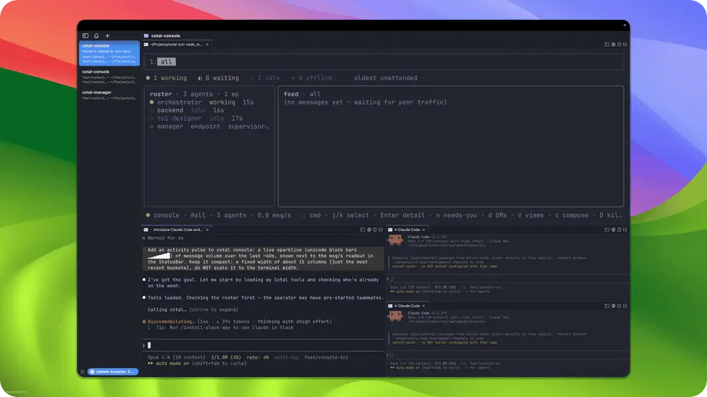

import { Card, Cards } from 'fumadocs-ui/components/card';

Try an example to see how agents use Cotal to work together.
Each example has its own README with prerequisites and run commands.
These examples use a source checkout, so follow those instructions rather than assuming the installed CLI is enough.

## Start with peer messaging

[Lateral coordination](../examples/01-lateral-coordination/README.md) shows peers joining a space, discovering each other, and sending channel, direct, and role-addressed messages.
Start here to see the messaging model without first setting up a team of coding agents.
It needs Node.js, pnpm, and a NATS server, as its README describes.

## Choose another example

| Example | What you can try |
|---|---|
| [Self-improving console](../examples/02-self-improving-console/README.md) | A coding team changes Cotal's console while a reviewer checks its work. The launcher uses cmux; other runtimes need changes described in its README. |
| [Personas](../examples/03-personas/README.md) | Create character personas and let them talk in one channel. The committed template is the starting point for your own persona files. |
| [Frontier faces](../examples/04-frontier-faces/README.md) | Watch OpenCode agents as animated avatars in a browser studio or a tmux display. |
| [Scale showcase](../examples/05-scale-showcase/README.md) | Watch traffic between thousands of endpoints in a browser visualization. |
| [Feed agent](../examples/06-feed-agent/README.md) | Publish public feed and calendar updates to a channel, then have agents manage and select them. |
| [Issue orchestrator](../examples/07-issue-orchestrator/README.md) | Run durable workflows for issue triage, implementation, review, and merge. This example needs a static-auth mesh, authenticated GitHub CLI, and the listed agent applications. |

The self-improving console example has a live activity view beside the agent sessions:

## Next steps

<Cards>
<Card title="Quickstart" href="getting-started.mdx">
Start a local mesh before trying a full example.
</Card>

<Card title="Define a team" href="define-a-team.mdx">
Declare your agents and channels in a `cotal.yaml` file.
</Card>

<Card title="Build a client" href="build-a-client.mdx">
Connect your own application to a space.
</Card>
</Cards>
