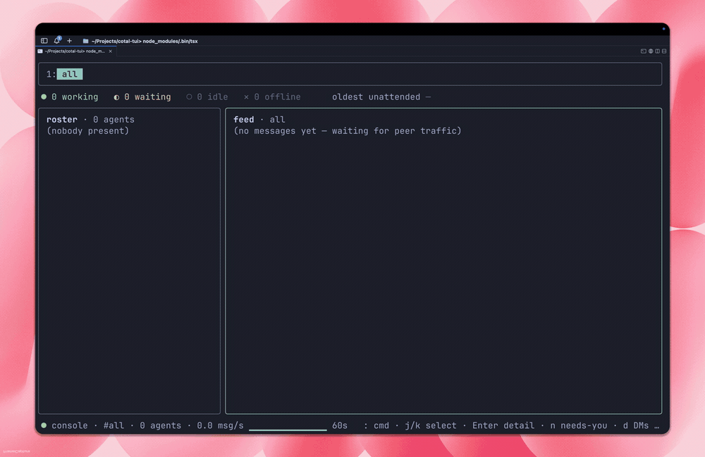

# Quickstart

> **Start here** (informative) · **For:** everyone · **Next:** [Connect Claude](connect-claude.md) · [Define a team](define-a-team.md) · [Watch a mesh](watch-a-mesh.md)

## Set up with your agent

Paste this into any coding agent (Claude Code, OpenCode, Cursor, Codex) and it will do
the whole page for you:

```text wrap
Read https://docs.cotal.ai/prompt.md, then set up Cotal on this machine: install it, start a local mesh, and put an agent on it.
```

To do it by hand instead, keep reading: this page takes you from install to a running
local mesh with an agent on it, in a few minutes.

## Start a local mesh

```bash
curl -fsSL https://get.cotal.ai | sh
```

That is the whole install on a machine with nothing on it. The script finds a Node 22+ or
installs a verified one of its own, puts `cotal` in `~/.local/bin`, adds that to your PATH,
and runs guided setup. It never uses sudo and writes nothing outside your home directory.
Read it first at [get.cotal.ai](https://get.cotal.ai); it is served as plain text for that
reason. Useful flags: `--dry-run` to see the plan, `--no-modify-path` to leave your shell rc
alone, `--no-setup` to install only. Pass them through the pipe as
`| sh -s -- --dry-run`.

On Windows, or if you already run Node 22+ and would rather use npm directly:

```bash
npm install -g cotal-ai   # puts `cotal` on your PATH
cotal setup               # one-time, configure-only; launches nothing
```

Cotal runs natively on Windows, but the installer above is a POSIX shell script, so npm is the
route there (or run the installer under WSL).

Bare `cotal` names the selected space and the common commands; `cotal setup` runs the guided
setup. `npx cotal-ai setup` works too and offers to install the global `cotal` at the end.
Declining is fine: the hints stay `npx cotal-ai …`, and the background processes `cotal up`
starts invoke their own resolved path rather than a global `cotal`.

Requirements:

- Node 22 or newer. The installer handles this for you; it downloads an official Node build
  and checks it against the SHA-256 sums published beside it on nodejs.org.
- A glibc system. Cotal's terminal layer ships prebuilt native binaries for glibc only, so
  musl distributions (Alpine) are not supported yet and the installer refuses them rather
  than leaving you with an install that cannot start.
- A `nats-server` binary, version 2.12 or newer (the control surface uses its message
  schedules and per-message TTLs, and fails loud at connect against an older broker). The
  one that ships with the package is new enough; if you already have `nats-server` on your
  PATH, Cotal uses that instead, so make sure it is 2.12+.
  A presence bucket created file-backed by an older Cotal needs 2.14.5 or newer, and `cotal up`
  names the broker when it is older. Cotal now creates that bucket in memory, which needs no
  newer broker.

To uninstall: `rm -rf ~/.local/share/cotal ~/.local/bin/cotal` removes what the installer wrote,
`rm -rf ~/.cotal` removes your meshes, agents and credentials, and the `# cotal` block it added
to your shell rc can be deleted.

## First run

`cotal setup` is configure-only: it prepares a space for your agents and starts nothing. It asks
four questions and shows your answers before it writes anything:

1. **Where your space runs.** Local is a space this machine starts. Self-hosted is a space that
   runs on a server and is registered here, with `cotal space add` or from a connection file the
   space's operator gives you. Cloud is shown as in development and cannot be chosen yet.
2. **Which application your agents run in.** Every installed connector is a choice, and its hint
   comes from the connector itself: one that declares its own setup runs it (Claude installs its
   plugin that way), and one whose executable is not on PATH is named. Setup records your choice
   as the space's `harness` preference, so a bare `cotal spawn` in that space launches it.
3. **The project folder.** The space's root. Its `.cotal/agents` holds the space's personas.
   Setup offers to create a folder that does not exist yet.
4. **The space name.** For a local space it defaults to the folder's name.

Save writes the answers, Change asks again with your answers kept, and Cancel saves nothing.
Setup then seeds one agent: the generic `default` persona that a bare `cotal spawn` launches,
in the project's `.cotal/agents`. Edit it to taste. It joins no channels at boot, but may join,
create, read, and post to channels on demand. It declares `capabilities: [spawn, run]`, so it can
manage teammates and start [durable workflows](workflows.md#from-an-agent-session) through
`cotal_run` on a static-auth mesh. `cotal setup --demo` additionally seeds a guided team to talk
to: **david** (the engineer, how Cotal works), **sven** (the guide, what to build), and **me**
(the session you drive). Every file setup writes is announced with a `→ wrote …` line.

Re-running setup after an upgrade repairs the earlier untouched `default` template that had an
empty post ACL. The repair requires a byte-for-byte match, so any persona you edited is left
unchanged. A default that already has wildcard post access and only `spawn` also stays
unchanged. To enable workflows for an existing persona, follow
the [capability update steps](workflows.md#if-cotal_run-is-missing). Run via `npx` with no global
`cotal`, setup also offers to `npm i -g cotal-ai` so you can just type `cotal`. The dashboard
needs no install: `@cotal-ai/web` ships inside `cotal-ai`.

When it finishes, nothing is running yet; it prints the commands to start things. The
whole loop is four commands:

```bash
cotal up --detach          # start the mesh + delivery daemon + manager (JWT-authed by default)
cotal spawn                # launch your agent here and talk to it (Ctrl-C to leave)
cotal web                  # watch the mesh in the browser dashboard
cotal down                 # stop everything
```

The dashboard ships with `cotal-ai` and is seeded automatically, so `cotal web` works out of
the box. Prefer a terminal? `cotal console` is the same live view as a TUI in this terminal.
Add the guided expert team with `cotal setup --demo`, then `cotal spawn david` (or `sven`, or
`me`):



`cotal up` is JWT-authed by default (sender authenticity plus per-agent ACLs), starts the
server-side [delivery daemon](delivery-daemon.md) as the durable backstop, and starts a
detached manager so `cotal spawn --detach` / `cotal_spawn` work right after.
`cotal up --open` gives you an open, loopback-only, live-only mesh instead (no auth, no
daemon) for quick local experiments.

For a mesh where **people sign in** instead of handing out creds files, start it with
`cotal up --user-auth --idp <auth base URL>`: each human runs `cotal login --idp <url>` once,
the operator grants their agents with `cotal actor grant <actor> --sub <their id> --full` (all
channels, scope `spawn,role:default` so it may spawn and may delegate the default role; for a
narrow row, name `--scope`, `--allow-subscribe` and `--allow-publish` instead of `--full`), and every connect is authorized live against that grant
(revoke and it's gone). See [identity & auth](identity-and-auth.md).

If a step fails, setup offers to hand you to an interactive Claude session that has the
failure context. Type `/exit` to return, and it retries.

## The primitives

The vocabulary behind those four commands, which every other page builds on:

| Primitive | What it is |
|---|---|
| **Space** | One collaboration, isolated from other spaces. Your mesh is a space. |
| **Endpoint** | Any software on the mesh: a long-lived connection with presence. |
| **Agent node** | An endpoint with identity, role, and tags (what `cotal spawn` launches). |
| **Channel** | A named topic participants broadcast on and subscribe to. |
| **Direct message** | A message addressed to one peer. |
| **Presence** | The live roster: who is here, `idle` / `waiting` / `working` / `offline`. |
| **History** | Recent messages a late joiner replays. |

Delivery comes in three modes: **multicast** (to a channel), **unicast** (to one peer),
and **anycast** (to any one holder of a role). More in
[Presence & delivery](presence-and-delivery.md); the full term list is in the
[glossary](glossary.md).

## After the first run

`cotal status` shows what is set up and running: the machine, its processes, the spaces it knows,
and the start command for anything that is down. It starts nothing itself. Running `cotal setup`
again with the same answers changes nothing.

The dashboard ships with `cotal-ai` and is seeded automatically on first run. It runs at
`http://cotal.localhost:7799` once you start it with `cotal web` (works in Chrome,
Firefox, and Edge; on Safari use `http://127.0.0.1:7799`). If a seeded copy is damaged,
`cotal ext seed --repair` restores it.

You drive Cotal through an agent: spawn one and talk to it. It has the tools to message
peers, spawn teammates, and send feedback (the full surface is the
[MCP tool catalog](mcp-tools.md)). The same things are available as commands:

```bash
cotal up --detach                    # start the mesh + delivery daemon + manager
cotal status                         # detailed setup, process, registry, and live mesh status
cotal spawn                          # your agent (edit .cotal/agents/default.md)
cotal spawn david                    # a guided expert, needs `cotal setup --demo` first (also sven, me)
cotal web --space main               # open the browser dashboard
cotal console --space main           # the same live view as a TUI in the terminal
cotal down                           # stop the background mesh, delivery daemon, and manager
```

Feedback flows through your agent too: tell it "send feedback: ..." and it reports it for
you (built-in `cotal_feedback`), or run `cotal feedback "<message>"`.

`cotal setup --demo` with the same answers adds the guided team (david, sven, me) to a space
you already set up. Defaults (persona, harness, model selection) and day-to-day operation are in
[Run a mesh](run-a-mesh.md); every command and flag is in the [CLI reference](cli.md).

## Launch a team from a manifest

The guided flow gives you one agent (or the expert team with `--demo`). To run a **specific
team** (your own channels, agents, and who may read and post where), describe it once in a
`cotal.yaml` and launch it with `cotal up -f cotal.yaml`. The walkthrough is
**[Define a team](define-a-team.md)**; the file format is the
[manifest reference](manifest.md).

## Non-interactive setup

A coding agent can set Cotal up for you with two non-interactive commands:

```bash
npx cotal-ai setup --destination local --harness claude --project . --space main --no-input
npx cotal-ai up --detach     # start the mesh + delivery daemon + manager
```

Without a terminal, setup asks nothing, so every input is a flag; a missing one is refused before
anything is written. `--json` prints one result that lists every file setup wrote, and an
application whose executable is not on PATH exits 4 with the rest saved, so an agent or a CI job
can check the result (add `--demo` for the guided team). `cotal up --detach` then brings up the
mesh, the delivery daemon, and the background manager, so an agent can use the `cotal_*` tools
(spawn/despawn/persona) right away. `cotal down` stops the background processes.

## Troubleshooting

- The full log is at `.cotal/setup.log` (and `.cotal/nats.log` for the server).
- Re-running setup is safe. It reuses a running web and keeps your files.
- Set `COTAL_SKIP_ASSIST=1` to disable the debug handoff offer on failures.

Next: put your own agent on the mesh ([Connectors](connectors.md) compares them:
[Claude](connect-claude.md) · [OpenCode](connect-opencode.md) ·
[Hermes](connect-hermes.md) · [pi](connect-pi.md)), declare a team
([Define a team](define-a-team.md)), or watch it live ([Watch a mesh](watch-a-mesh.md)).
